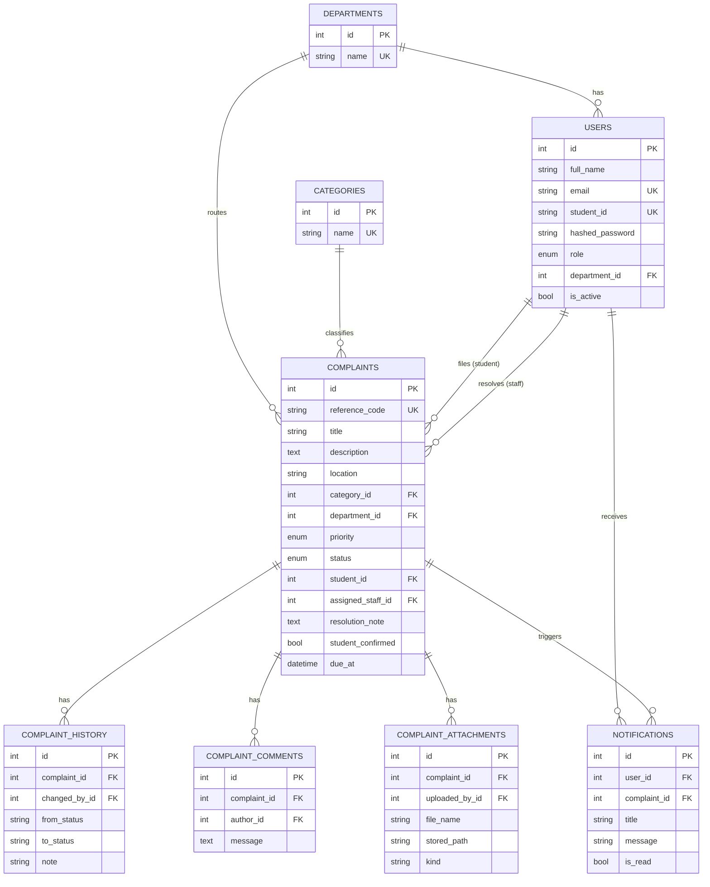

# Database Design

CampusResolve uses a normalized relational schema (3NF) on PostgreSQL (or
SQLite for local development). See `database/schema.sql` for the full DDL
and `backend/app/models/models.py` for the SQLAlchemy source of truth.

## Entity-Relationship Diagram

## Normalization Notes

- **1NF**: every column holds a single atomic value; no repeating groups.
- **2NF**: all non-key attributes depend on the whole primary key (all
  tables use single-column surrogate `id` keys, so this is automatic).
- **3NF**: non-key attributes depend only on the key, not on each other —
  e.g. `department_id` is stored on `users` and `complaints` as a foreign
  key rather than duplicating the department name as a string.

## Key Design Decisions

- `complaints.reference_code` is a short, human-friendly identifier
  (e.g. `CR-2601-04821`) shown to users, separate from the internal
  auto-increment `id` used for joins.
- `complaint_history` is append-only: every status transition is recorded,
  giving a full audit trail without mutating prior rows.
- `due_at` is computed once at creation/assignment time from the SLA rules
  in `app/services/sla.py`, rather than recalculated on every request.
- Attachments store a `kind` (`evidence` vs `resolution`) so the UI can
  distinguish what the student submitted from what staff uploaded as proof
  of the fix.
