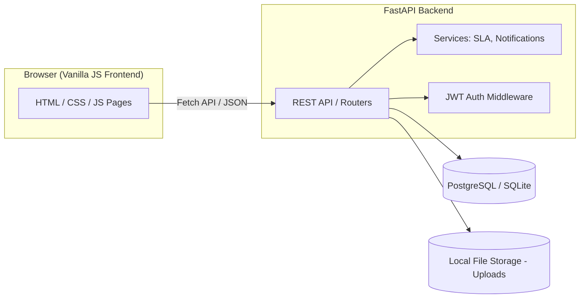
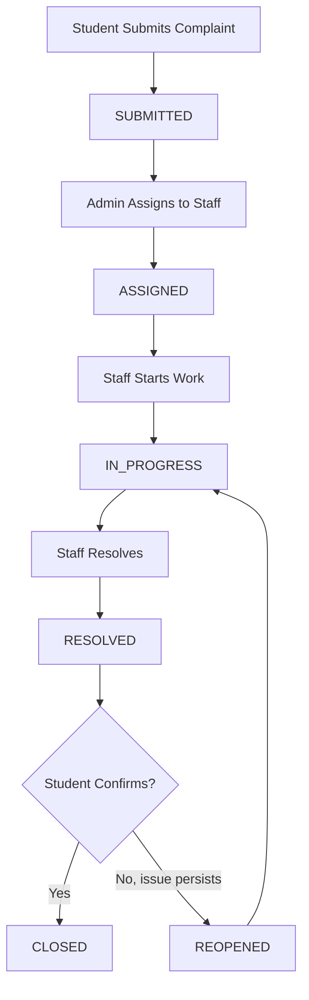

# Project Report — Smart Campus Complaint & Issue Tracking System (CampusResolve)

## Abstract

CampusResolve is a web-based complaint and issue tracking system designed
for college campuses. It replaces informal, hard-to-track complaint
channels (verbal reports, scattered emails) with a structured workflow in
which students submit complaints, administrators route them to the
appropriate staff, and staff resolve and document fixes — all visible to
the student in real time, with a built-in reopen mechanism if the fix
doesn't hold.

## Problem Statement

Campus facilities issues (broken equipment, plumbing, electrical faults,
network outages, etc.) are commonly reported informally, with no central
record of what was reported, who is responsible, or whether it was
actually fixed. This leads to lost reports, duplicate work, and no
accountability trail.

## Objectives

1. Provide students a simple way to report issues with category, location
   and priority.
2. Give administrators a single dashboard to triage and assign complaints.
3. Give staff a clear queue of assigned work with status tracking.
4. Maintain a complete, auditable history of every complaint.
5. Notify all parties automatically as status changes.
6. Surface SLA/overdue complaints so nothing silently stalls.

## Existing System

Most campuses rely on manual processes: paper forms, word-of-mouth, or
general-purpose email inboxes. These have no structured status tracking,
no SLA visibility, no searchable history, and no accountability for who
is responsible for a given issue.

## Proposed System

CampusResolve digitizes the entire lifecycle: submission → categorization
→ assignment → resolution → confirmation → (optional) reopening → closure,
backed by a relational database, role-based access control, and real-time
notifications.

## Advantages

- Centralized, searchable record of every complaint
- Clear accountability (every complaint has an assigned owner)
- SLA-based overdue tracking surfaces neglected issues
- Reopen workflow ensures issues aren't closed prematurely
- Role-appropriate dashboards reduce noise for each user type

## Scope

In scope: complaint submission, categorization, assignment, status
workflow, comments, file attachments, notifications, dashboards, search/
filter/sort, SLA tracking, admin user/category/department management.

Out of scope (see Known Limitations in the README): mobile native apps,
email/SMS delivery of notifications (in-app only), multi-campus/tenant
support, admin-editable SLA rules via UI (currently code-configured).

## Functional Requirements

See README "Features" and `docs/API_DOCUMENTATION.md` for the complete,
implemented set of functional requirements (registration, login, complaint
CRUD, assignment, status transitions, comments, attachments, notifications,
dashboards, search/filter/sort, admin user & catalog management).

## Non-Functional Requirements

- **Security**: JWT auth, bcrypt password hashing, role-based authorization
  on every protected endpoint, parameterized queries via SQLAlchemy (no
  raw SQL string interpolation), validated file uploads.
- **Usability**: responsive layout (desktop and mobile), consistent status/
  priority badges, toasts for action feedback, empty/loading/error states
  on every data view.
- **Maintainability**: layered backend (routers → services → models),
  typed request/response schemas (Pydantic), Alembic-tracked schema
  changes.
- **Portability**: runs on SQLite with zero setup or PostgreSQL for
  production; Dockerized for one-command startup.

## Technology Stack

See README "Technology Stack" table.

## System Architecture

## Complaint Workflow

## Database Design

See `docs/DATABASE_DESIGN.md` for the full ER diagram and normalization
notes.

## Modules

1. Authentication & Authorization Module
2. Complaint Management Module (create, view, search/filter/sort)
3. Assignment & Workflow Module (status transitions, history)
4. Notification Module
5. Dashboard & Reporting Module
6. Admin Catalog Module (categories, departments, staff accounts)
7. File Attachment Module

## Testing

See `docs/TESTING.md`.

## Future Scope

- Admin-configurable SLA rules via UI
- Email/SMS notification delivery alongside in-app notifications
- Analytics export (CSV/PDF reports)
- Mobile app client
- Multi-campus / multi-tenant support

## Conclusion

CampusResolve demonstrates a complete, production-shaped full-stack system
covering authentication, role-based workflows, a normalized relational
database, REST API design, and a usable frontend — suitable both as a
third-year academic project and as a working tool for small-to-medium
campus deployments.
